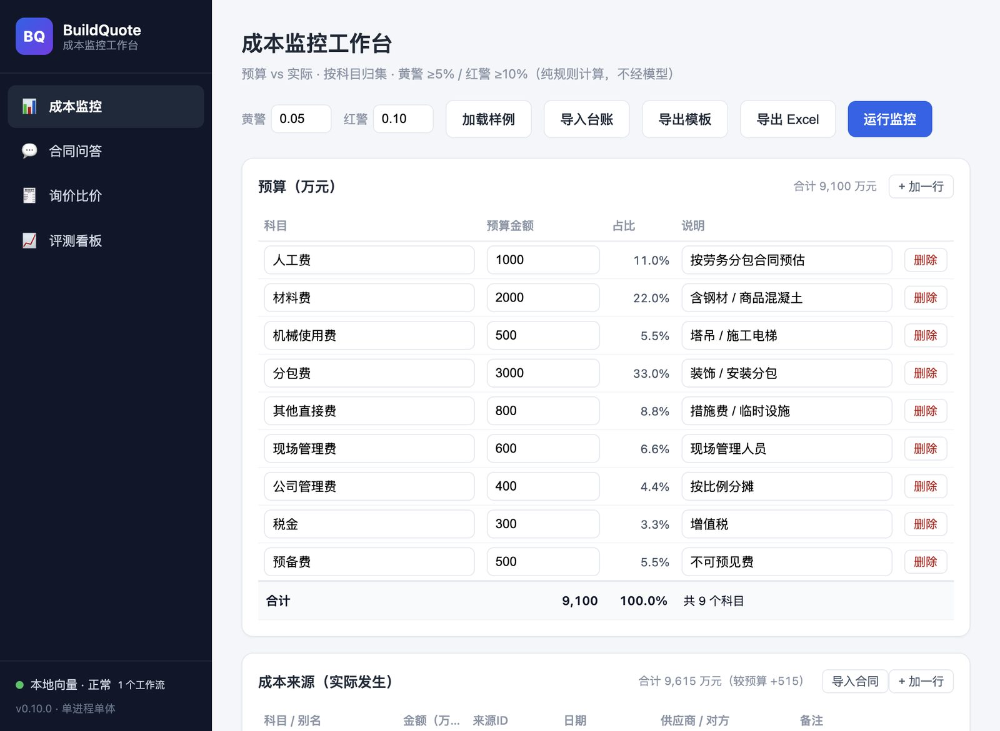
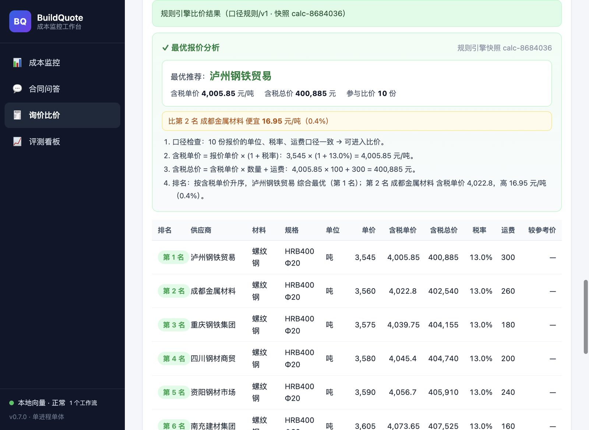
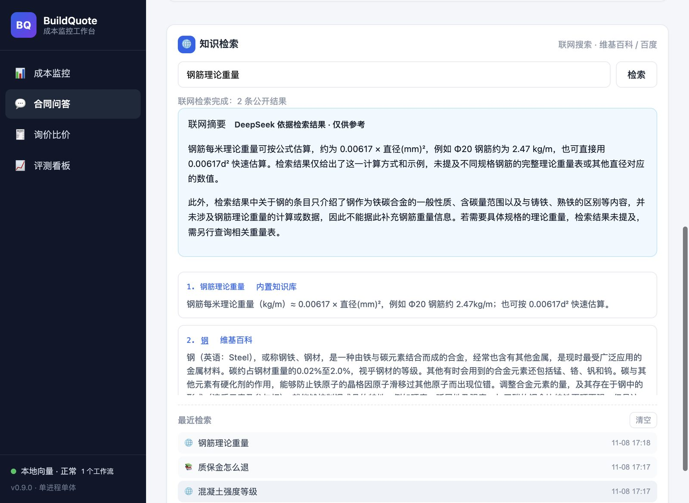
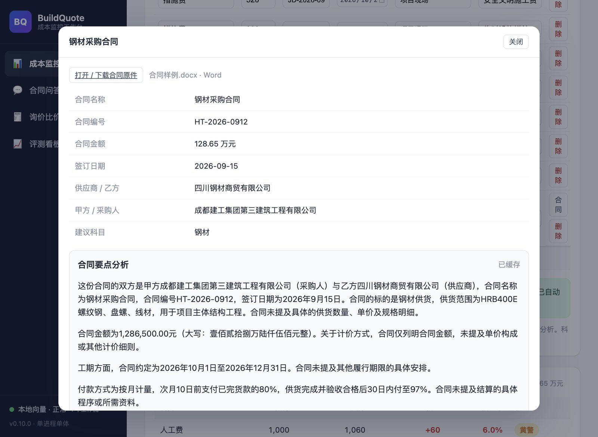
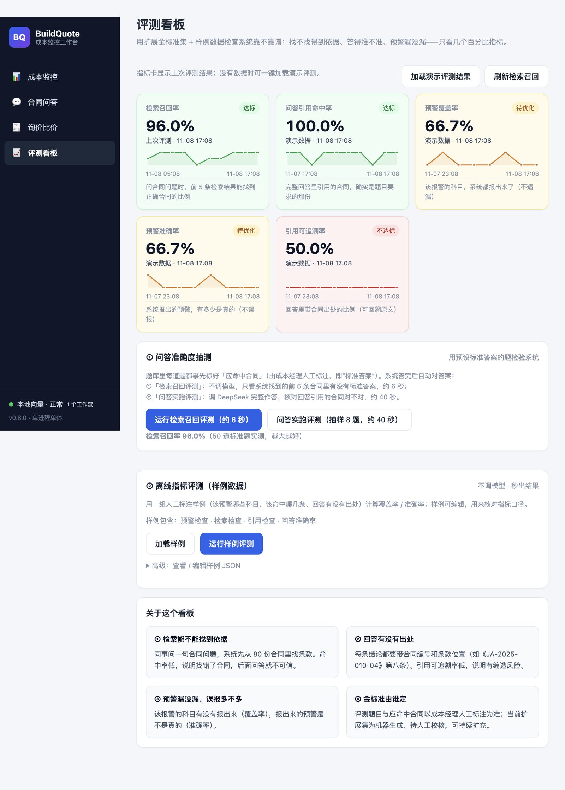
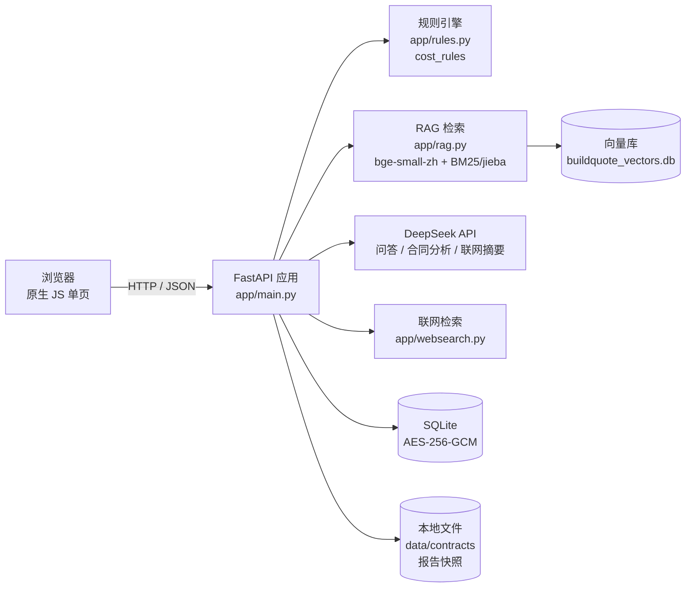

<p align="center">
  
</p>

<h1 align="center">BuildQuote · 成本监控工作台</h1>

<p align="center">
  面向房建项目的成本全过程闭环 MVP：<b>预算监控 · 合同问答 · 询价比价 · 合同导入 · 报告导出 · 质量评测</b><br/>
  纯规则引擎算钱，模型只做解释与摘要，每一笔数字都能追溯到依据。
</p>

<p align="center">
  
  
  
  
  
  
  
  <a href="https://github.com/liu-yanling/BuildQuote/actions/workflows/ci.yml"></a>
  <a href="https://github.com/liu-yanling/BuildQuote/releases"></a>
  
</p>

---

## 📖 目录

- [项目简介](#-项目简介)
- [在线体验](#-在线体验)
- [功能特性](#-功能特性)
- [界面预览](#-界面预览)
- [设计红线](#-设计红线)
- [技术架构](#-技术架构)
- [目录结构](#-目录结构)
- [快速开始](#-快速开始)
- [配置说明](#-配置说明)
- [部署上线](#-部署上线)
- [测试与评测](#-测试与评测)
- [常见问题](#-常见问题)
- [版本记录](#-版本记录)
- [Roadmap](#-roadmap)

---

## 🏗 项目简介

BuildQuote 是一个**房建项目成本管理**的可运行 MVP，面向施工企业成本经理/项目部：

- 预算 vs 实际按科目归集，自动算偏差并给出**黄警 / 红警**；
- 合同、进度款、签证三源成本台账，支持导入/导出 Excel；
- 合同**导入即解析**：金额、日期、编号、供应商自动填行，点开即可查看原件与「合同要点分析」；
- 合同知识库 RAG：自然语言问合同条款，回答带《合同编号》第 X 条引用；知识检索支持**联网搜索**建筑行业通用知识；
- 询价比价五步闭环：建需求 → 收报价 → 核口径 → 做比价 → 出报告，报价单可导入 PDF/Word/Excel 并自动给出**最优报价分析**；
- 报告审核通过后导出真实 **PDF / Word**；
- 评测看板：检索召回率、问答引用命中率、预警覆盖率/准确率、引用可追溯率，带历史趋势图。

> 定位：单进程单体、开箱即用的演示/内测版本；数据落本地 SQLite + 本地向量库，适合私有化部署。

---

## 🌐 在线体验

> 演示环境运行在一台临时公网隧道上（服务重启后地址会变化，仅供体验）：
>
> **https://4ef294307cd29c4b-50-7-252-188.serveousercontent.com**
>
> 首次打开若出现 Serveo 提示页，点 **Continue to Site** 即可进入。长期稳定上线方式见 [DEPLOY.md](DEPLOY.md)。

---

## ✨ 功能特性

| 模块 | 核心能力 | 关键点 |
| --- | --- | --- |
| 📊 **成本监控** | 预算/成本来源录入、导入台账、导出 Excel、运行监控 | 规则引擎计算台账与偏差；黄警 ≥5% / 红警 ≥10% 可调 |
| 📄 **合同导入** | PDF / Word / Excel 合同自动识别，自动填一行成本来源 | 名称/编号/金额/日期/甲方乙方/建议科目；文件存档可查看 |
| 🔍 **合同详情** | 打开/下载合同原件、解析字段、**合同要点分析** | DeepSeek 仅依据合同原文总结；未提及会明确说明，不编造 |
| 💬 **合同问答** | 合同条款自然语言问答，带出处引用 | 本地 bge-small-zh + BM25 混合检索；对话历史自动保存 |
| 🌐 **知识检索** | 本地合同库 / 联网搜索（维基百科 + 百度 + 内置知识） | 🌐 开关切换；联网摘要带 [n] 来源编号，标注仅供参考 |
| 🧾 **询价比价** | 五步闭环 + 规则引擎排名 + 最优报价分析 | ≥3 家供应商可比；口径（单位/税率/运费）自动检查 |
| 📥 **报价单导入** | PDF / Word / Excel 自动识别报价行 | 导入后自动回填并比价，给出最优推荐与计算过程 |
| 📤 **报告导出** | 审核通过后导出真实 PDF / Word | 报告快照固化；未审核不可导出 |
| 📈 **评测看板** | 5 项质量指标 + 历史趋势迷你图 | 50 题检索评测约 6 秒；支持一键加载演示评测结果 |

---

## 🖼 界面预览

<table>
  <tr>
    <td width="50%"><br/><sub><b>成本监控</b>：预算 vs 实际、预警、合同导入</sub></td>
    <td width="50%"><br/><sub><b>询价比价</b>：最优报价分析 + 10 家供应商排名</sub></td>
  </tr>
  <tr>
    <td width="50%"><br/><sub><b>合同问答</b>：知识检索（本地/联网）+ 历史记录</sub></td>
    <td width="50%"><br/><sub><b>合同导入</b>：自动解析字段 + 合同要点分析</sub></td>
  </tr>
</table>

<p align="center">
  <br/>
  <sub><b>评测看板</b>：5 项质量指标 + 历史趋势迷你图 + 一键演示</sub>
</p>

---

## 🚦 设计红线

这些是项目运行中**不可妥协**的约束，也是选择"规则引擎 + 可追溯"的原因：

1. **数字只出自规则引擎**：金额、偏差、比价排名、预警级别全部由确定性规则计算，模型只解释、不计算。
2. **模型不碰导出**：报告生成/导出发生在成本经理审核通过、快照固化之后；模型无导出权限。
3. **合同原文不可篡改**：合同证据、OCR 原文只读；清洗与展示层不改动原始文本。
4. **识别结果需人工确认**：合同/报价单自动识别是"候选字段"，进入比价与台账前必须人工确认。
5. **联网只用于通用知识**：合同结论必须来自合同原文；联网检索仅服务建筑行业基础知识查询。

---

## 🧱 技术架构



- 后端：Python 3.12 + FastAPI + Uvicorn（单进程、单 worker）
- 前端：原生 JS 单页（无构建步骤），4 个视图
- 存储：SQLite（AES-256-GCM 加密）+ 本地文件 + 本地向量库
- 模型：DeepSeek（`deepseek-chat`，httpx 直连）；Embedding：本地 `bge-small-zh-v1.5`（fastembed）
- 测试：pytest（72 个用例）

---

## 📁 目录结构

```text
BuildQuote/
├── app/
│   ├── main.py            # FastAPI 入口：全部 HTTP 接口
│   ├── serve.py           # 生产启动入口（调度 + 代理头）
│   ├── rules.py           # 规则引擎：预算偏差 / 比价 / 报告快照
│   ├── rag.py             # RAG：切块、检索、引用
│   ├── qa.py              # 合同问答（自然语言 + 引用）
│   ├── quote_import.py    # 报价单导入（PDF/Word/Excel）
│   ├── contract_import.py # 合同导入与要点分析
│   ├── websearch.py       # 联网检索（百科 + 网页 + 内置知识）
│   ├── cost_io.py         # 成本台账导入 / 导出 Excel
│   ├── export.py          # 真实报告导出（PDF / Word）
│   ├── static/            # 前端页面、样式、脚本、logo
│   └── ...
├── skills/                # 成本科目、口径规则（可配置）
├── evals/                 # 评测集（50 题检索 + 核心问答题）
├── examples/              # 合同/报价单导入演示文件
├── scripts/               # 知识库灌入、样例生成、公网隧道等
├── tests/                 # pytest 用例
├── Dockerfile / docker-compose.yml
└── DEPLOY.md              # 上线部署指南
```

> `data/`（数据库、向量库、合同原件、评测历史）为运行态数据，**不进入版本库**。

---

## 🚀 快速开始

### 1. 环境要求

- Python **3.12**
- 可访问外网（DeepSeek API；首次启动下载本地向量模型约 100MB）

### 2. 安装依赖

```bash
git clone https://github.com/liu-yanling/BuildQuote.git
cd BuildQuote
python -m venv .venv && source .venv/bin/activate
pip install -r requirements.txt
```

### 3. 配置

```bash
cp .env.example .env
# 必填：MODEL_API_KEY / DATA_KEY / SESSION_SECRET
# 生成密钥：openssl rand -hex 32
```

### 4. 启动

```bash
python -m app.serve          # 生产入口（含定时催收调度）
# 或开发模式：uvicorn app.main:app --reload --port 8010
```

打开 http://127.0.0.1:8010 即可。

### 5. 初始化演示数据（可选）

- 成本监控：点「加载样例」直接体验 9 个科目 / 16 笔成本来源；
- 合同导入：用 `examples/合同样例.xlsx/.docx/.pdf` 试导入；
- 报价单导入：用 `examples/报价单样例.xlsx/.docx/.pdf` 试导入；
- 合同问答知识库：把合同 OCR 文本放到 `inbox/合同OCR文本/*.txt`，执行
  `python scripts/ingest_contracts.py` 灌入向量库（文件名含合同编号，如 `JA-2025-010-04.txt`）。

---

## ⚙️ 配置说明

| 环境变量 | 必填 | 说明 |
| --- | --- | --- |
| `MODEL_API_KEY` | ✅ | DeepSeek API Key |
| `MODEL_BASE_URL` | | 默认 `https://api.deepseek.com` |
| `MODEL_NAME` | | 默认 `deepseek-chat` |
| `MODEL_TIMEOUT` | | 模型超时秒数，默认 60 |
| `DATA_KEY` | ✅ | AES-256-GCM 密钥（≥32 字符，`openssl rand -hex 32`） |
| `SESSION_SECRET` | ✅ | 会话密钥（≥32 字符） |
| `DB_PATH` | | SQLite 路径，默认 `data/buildquote.db` |
| `EMBEDDING_BACKEND` | | 默认 `local_model`（本地 bge-small-zh，免费） |
| `ALERT_YELLOW_RATIO` | | 黄警阈值，默认 `0.05` |
| `ALERT_RED_RATIO` | | 红警阈值，默认 `0.10` |
| `APP_USERNAME` / `APP_PASSWORD` | | 可选：公网访问开启 HTTP Basic 登录 |

> `.env` 已被 `.gitignore` 忽略，**切勿提交**。

---

## ☁️ 部署上线

完整步骤见 **[DEPLOY.md](DEPLOY.md)**，最简方式：

```bash
cp .env.example .env && vi .env     # 填 3 个必填项
docker compose up -d --build        # 服务器上一条命令
curl http://127.0.0.1:8010/health   # {"status":"ok", ...}
```

- 域名 + HTTPS：用 Caddy 反代 `127.0.0.1:8010`（自动证书），Nginx 示例见 DEPLOY.md
- 数据持久化：`data/` 卷（SQLite / 向量库 / 合同原件 / 评测历史）
- 健康检查：`GET /health`
- 临时公网演示：`bash scripts/start_public_tunnel.sh`（Serveo 临时地址，URL 不固定）

---

## 🧪 测试与评测

```bash
# 单元测试（72 个用例，覆盖规则/导出/导入/评测/问答）
pytest -q

# 问答抽查（命令行）
PYTHONPATH=. .venv/bin/python scripts/eval_qa.py
```

评测看板（页面内）：

- 检索召回评测：50 道标准题，约 6 秒；
- 问答实跑评测：抽样 8 题调 DeepSeek 完整作答，约 40 秒；
- 离线指标评测：样例数据即时出结果；
- 一键加载演示评测结果（无需真实数据）。

---

## ❓ 常见问题

<details>
<summary><b>启动报「缺少必需配置」？</b></summary>
`.env` 未填 `MODEL_API_KEY` / `DATA_KEY` / `SESSION_SECRET`，按 <a href="#-配置说明">配置说明</a>补齐。
</details>

<details>
<summary><b>页面能开但问答/分析报错？</b></summary>
检查 DeepSeek Key 是否有效、账户余额、服务器是否能访问 <code>api.deepseek.com</code>。
</details>

<details>
<summary><b>合同/报价单识别不准？</b></summary>
自动识别是候选字段，识别后请人工核对金额/日期；扫描版 PDF 需先 OCR。
</details>

<details>
<summary><b>能否多 worker 部署？</b></summary>
不建议。SQLite、本地向量库、定时催收按单进程设计，请保持 <b>单 worker</b>。
</details>

---

## 🗓 版本记录

| 版本 | 主要内容 |
| --- | --- |
| v0.5.3 | 真实报告导出（PDF/Word）、成本台账导入导出、评测看板上线 |
| v0.6.0 | 询价五步演示流程重做（演示数据前置 + 步骤引导） |
| v0.7.0 | 报价单导入（PDF/Word/Excel）+ 最优报价分析 + 10 条演示数据 |
| v0.8.0 | 评测提速到 50 题 / 6 秒 + 演示一键加载 + 指标趋势图 |
| v0.9.0 | 知识检索联网搜索（🌐）+ 检索/对话历史 |
| v0.10.0 | 成本来源去掉来源类型列 + 合同导入自动填行 + 合同查看/要点分析 |

---

## 🗺 Roadmap

- [ ] 多项目 / 多企业空间与权限体系（当前为单项目演示）
- [ ] 合同模板库与条款抽取审核流
- [ ] 成本预测（趋势外推）与月度对比报表
- [ ] 报告在线预览（PDF.js）与电子签章
- [ ] 移动端适配

---

## 📄 许可与联系

- 本仓库公开托管仅用于**作品展示与技术交流**；未经作者书面许可，不得商用、二次分发或对外提供服务（见 [LICENSE](LICENSE)）。
- 作者：刘燕玲 · GitHub [@liu-yanling](https://github.com/liu-yanling)
- 合作 / 商用 / 定制：欢迎通过 GitHub 或站点联系。

<p align="center"><sub>BuildQuote · 让每一笔成本都有据可查</sub></p>
